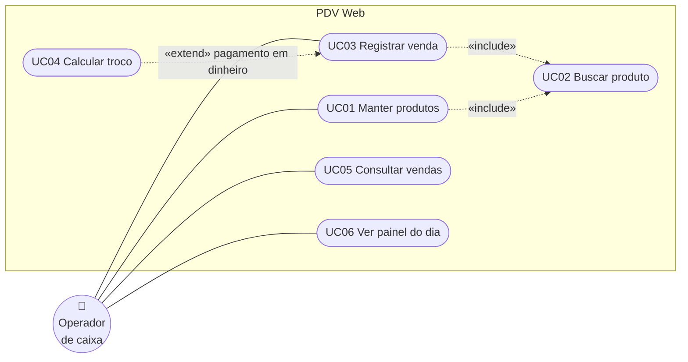
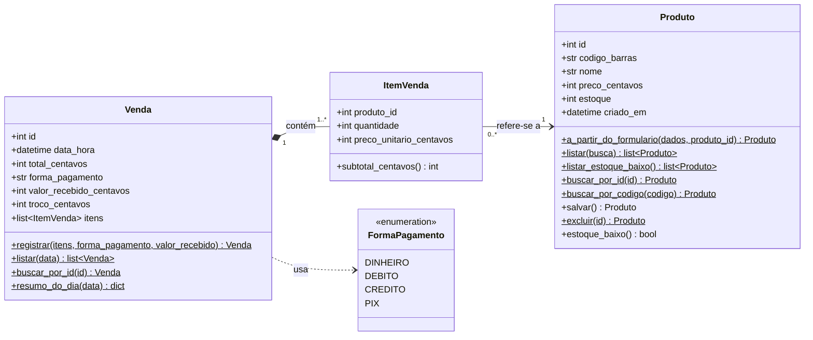
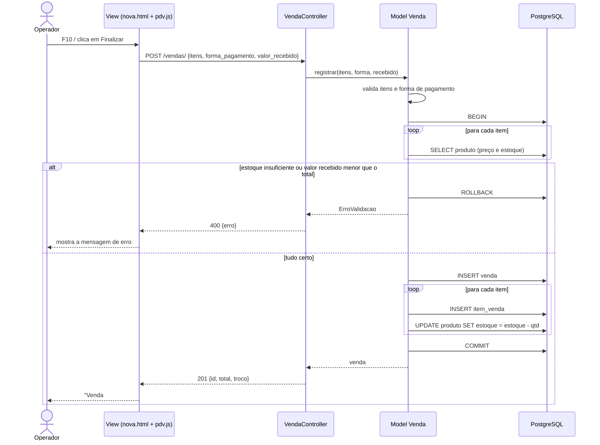
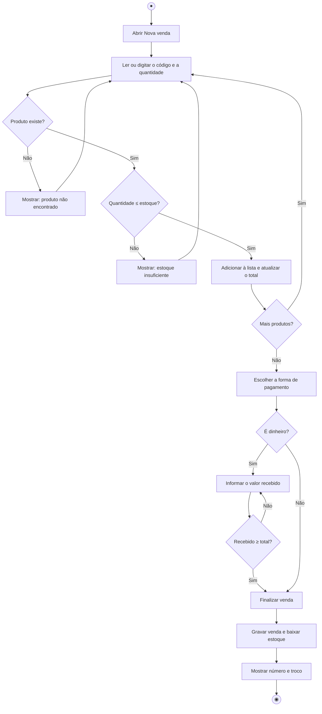
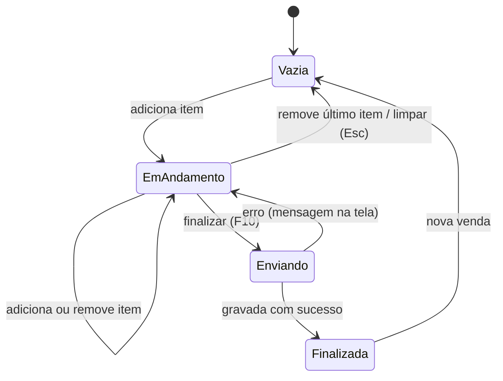

# 2. Modelagem UML

Os diagramas estão em [Mermaid](https://mermaid.js.org/), que o GitHub desenha automaticamente ao abrir
este arquivo.

## 2.1 Diagrama de casos de uso

Ator: **Operador de caixa**, que também é quem cadastra os produtos.

### Especificação do caso de uso principal: UC03 Registrar venda

| Item | Descrição |
|---|---|
| **Ator** | Operador de caixa |
| **Pré-condição** | Existem produtos cadastrados com estoque |
| **Pós-condição** | A venda e seus itens estão gravados e o estoque foi reduzido |
| **Fluxo principal** | 1. O operador abre "Nova venda". 2. O sistema posiciona o cursor no campo de código de barras. 3. O operador lê ou digita o código, informa a quantidade e tecla Enter. 4. O sistema busca o produto e o adiciona à lista, atualizando o total. 5. Os passos 3 e 4 se repetem até o fim da compra. 6. O operador escolhe a forma de pagamento. 7. O operador finaliza com o botão ou com F10. 8. O sistema grava a venda, baixa o estoque e mostra o número da venda e o troco. |
| **Fluxo alternativo A1**: produto sem código | No passo 3, o operador abre "Buscar pelo nome", digita parte do nome e clica no produto. |
| **Fluxo alternativo A2**: pagamento em dinheiro | No passo 6, o operador informa o valor recebido e o sistema mostra o troco (UC04). |
| **Fluxo alternativo A3**: remover item | A qualquer momento, o operador clica em "Remover" num item ou em "Limpar venda" (Esc). |
| **Exceção E1** | Código inexistente: o sistema mostra "Nenhum produto com o código X". |
| **Exceção E2** | Quantidade maior que o estoque: o sistema mostra "Estoque insuficiente… Disponível: N" e não adiciona o item. |
| **Exceção E3** | Valor recebido menor que o total: o botão Finalizar fica desabilitado e o troco aparece como "—". |
| **Exceção E4** | Falha de conexão: o sistema mostra "Sem conexão com o servidor. A venda não foi gravada." |

## 2.2 Diagrama de classes

> O `preco_unitario_centavos` fica gravado no item para que o histórico não mude quando o preço do produto
> for alterado depois.

## 2.3 Diagrama de sequência: finalizar venda

## 2.4 Diagrama de atividades: registrar venda

## 2.5 Diagrama de estados: venda na tela de caixa

