# 3. IHC: Interface Humano-Computador

## 3.1 Princípios aplicados

| Princípio (material da disciplina) | Como foi aplicado no PDV Web |
|---|---|
| **Clara** | Cada tela tem um único objetivo e título. O total da venda aparece em destaque, em fonte grande. |
| **Consistente** | Mesmo menu em todas as telas, mesmas cores para ações (verde = principal, cinza = secundária, vermelho = excluir/remover), mesmo formato de dinheiro (R$ 1.234,56). |
| **Simples** | A busca por nome fica escondida em "Não tem código?" e só aparece quando necessária (divulgação progressiva). |
| **Controlada pelo usuário** | Nada acontece sozinho: o operador decide quando adicionar, remover e finalizar. |
| **Direta** | Ao ler o código, o item aparece na lista e o total muda na hora (causa e efeito visíveis). |
| **Empática / reversível** | Itens podem ser removidos antes de finalizar; "Limpar venda" e "Excluir produto" pedem confirmação; os formulários mantêm o que foi digitado quando há erro. |
| **Dá resposta (feedback)** | Mensagens de sucesso e de erro após cada ação; botão Finalizar desabilitado enquanto a venda não está pronta; janela de confirmação com o número da venda e o troco. |

Também foram considerados: atalhos de teclado para quem usa leitor de código de barras (Enter, F10, Esc),
foco automático no campo de código, layout que se adapta ao celular e campos de erro marcados com
`aria-invalid` para leitores de tela.

## 3.2 Mapa de navegação

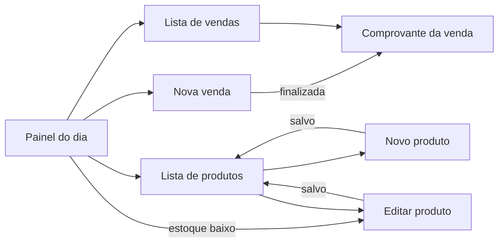

O menu superior (Início, Nova venda, Vendas, Produtos) está presente em todas as telas.

## 3.3 Mapa conceitual

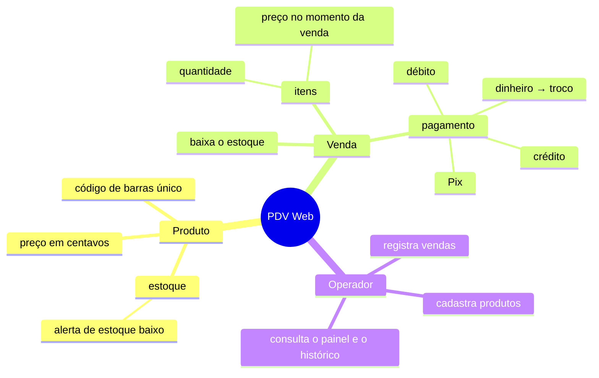

## 3.4 Protótipo (telas do sistema)

As imagens abaixo são do sistema funcionando, e não apenas um esboço.

| Tela | Imagem |
|---|---|
| Painel do dia | 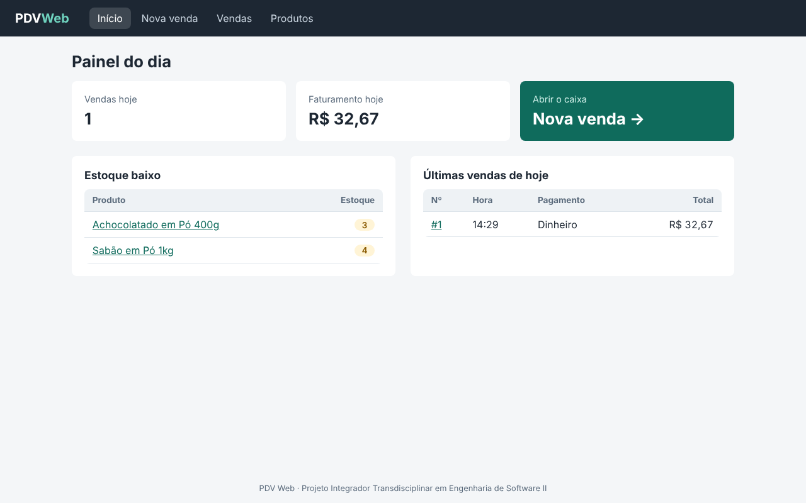 |
| Lista de produtos | 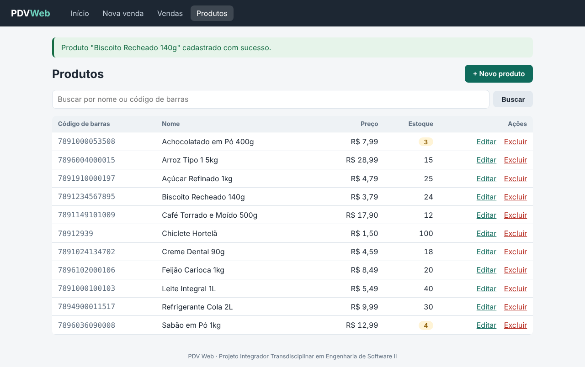 |
| Cadastro com erros de validação | 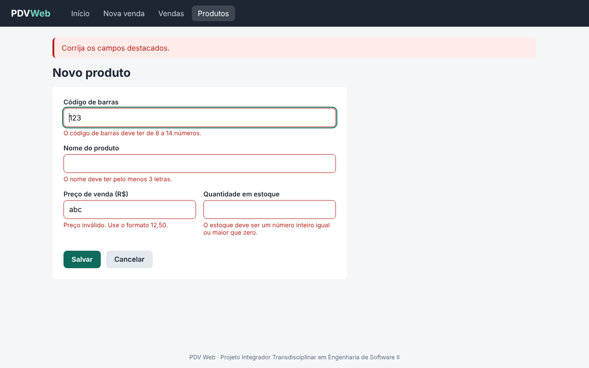 |
| Nova venda (caixa) | 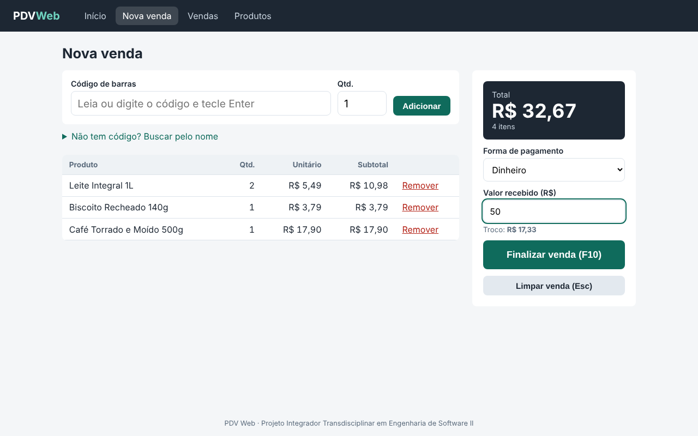 |
| Venda finalizada | 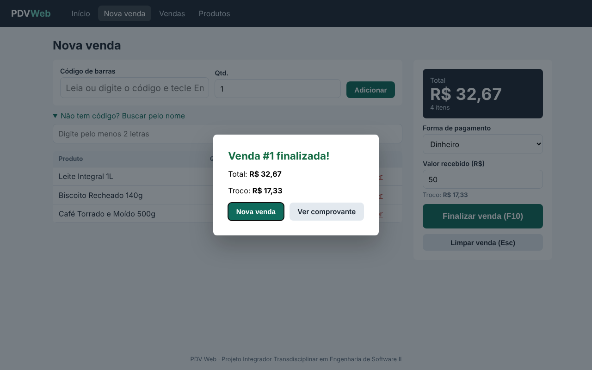 |
| Comprovante | 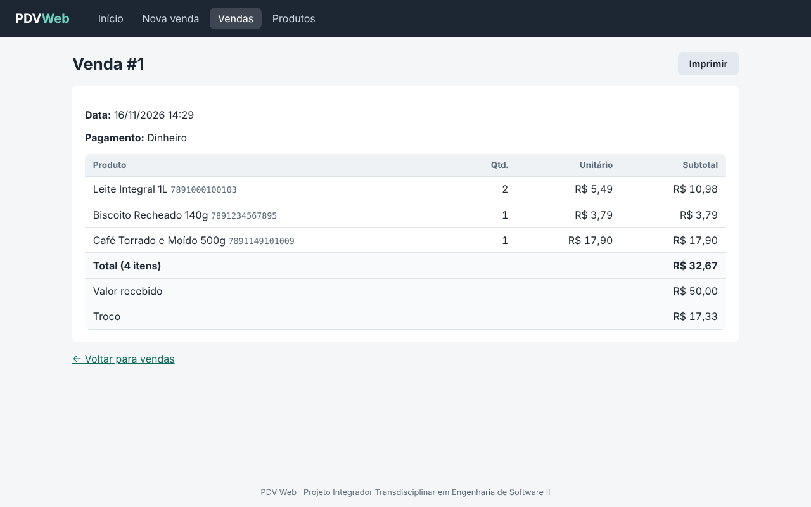 |
| Histórico de vendas | 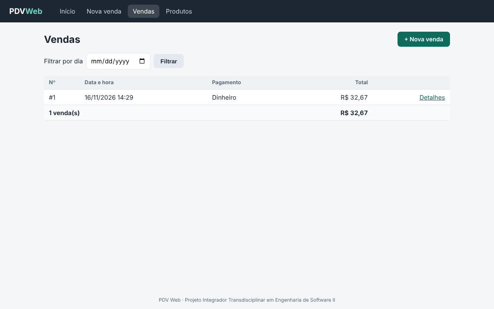 |
| Página de erro 404 | 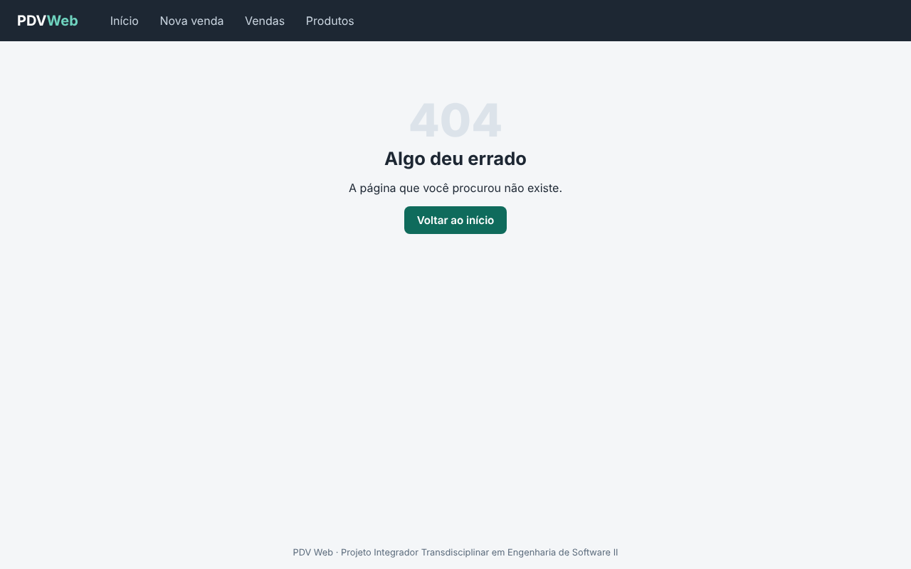 |
| Nova venda no celular | 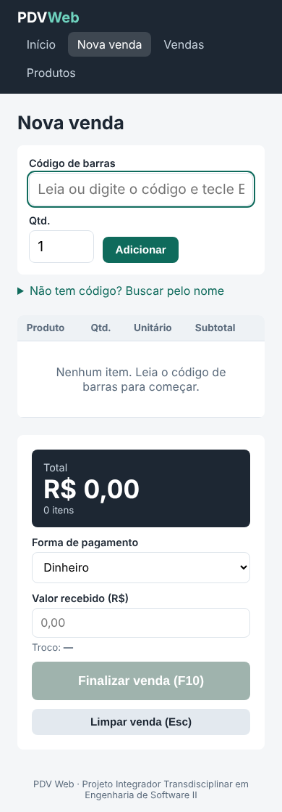 |

## 3.5 Catálogo de mensagens

### Erros de validação (formulário de produto)

| Código | Situação | Mensagem exibida |
|---|---|---|
| MSG01 | Código de barras vazio | Informe o código de barras. |
| MSG02 | Código fora do padrão | O código de barras deve ter de 8 a 14 números. |
| MSG03 | Código repetido | Já existe um produto com este código: *nome*. |
| MSG04 | Nome curto | O nome deve ter pelo menos 3 letras. |
| MSG05 | Nome longo | O nome deve ter no máximo 100 caracteres. |
| MSG06 | Preço inválido | Preço inválido. Use o formato 12,50. |
| MSG07 | Preço zero | O preço deve ser maior que zero. |
| MSG08 | Estoque inválido | O estoque deve ser um número inteiro igual ou maior que zero. |
| MSG09 | Qualquer erro no formulário (topo) | Corrija os campos destacados. |
| MSG10 | Excluir produto já vendido | O produto "*nome*" já aparece em vendas e não pode ser excluído. Se não for mais vendido, deixe o estoque em zero. |

### Erros na tela de venda

| Código | Situação | Mensagem exibida |
|---|---|---|
| MSG11 | Enter com o campo vazio | Digite ou leia um código de barras. |
| MSG12 | Código com letras ou tamanho errado | Código inválido: use de 8 a 14 números. |
| MSG13 | Código não cadastrado | Nenhum produto com o código *X*. |
| MSG14 | Quantidade inválida | A quantidade deve ser um número inteiro maior que zero. |
| MSG15 | Quantidade maior que o estoque | Estoque insuficiente para "*nome*". Disponível: *N*. |
| MSG16 | Finalizar sem itens (servidor) | Adicione pelo menos um produto antes de finalizar a venda. |
| MSG17 | Valor recebido menor que o total | O valor recebido é menor que o total da venda. (Na tela, o botão Finalizar fica desabilitado e o troco aparece como "—".) |
| MSG18 | Valor recebido com formato errado | Valor recebido inválido. Use o formato 50,00. |
| MSG19 | Servidor fora do ar | Sem conexão com o servidor. A venda não foi gravada. |

### Erros gerais

| Código | Situação | Mensagem exibida |
|---|---|---|
| MSG20 | Página inexistente (404) | A página que você procurou não existe. |
| MSG21 | Erro inesperado (500) | Ocorreu um erro inesperado. Tente novamente; se continuar, avise o suporte. |
| MSG22 | Data inválida no filtro de vendas | Data inválida. |

### Mensagens de sucesso e confirmação

| Código | Situação | Mensagem exibida |
|---|---|---|
| MSG30 | Produto cadastrado | Produto "*nome*" cadastrado com sucesso. |
| MSG31 | Produto alterado | Produto "*nome*" atualizado. |
| MSG32 | Produto excluído | Produto "*nome*" excluído. |
| MSG33 | Confirmar exclusão | Excluir o produto "*nome*"? Esta ação não pode ser desfeita. |
| MSG34 | Confirmar limpeza da venda | Limpar todos os itens desta venda? |
| MSG35 | Venda finalizada | Venda #*N* finalizada! Total… Troco… |
