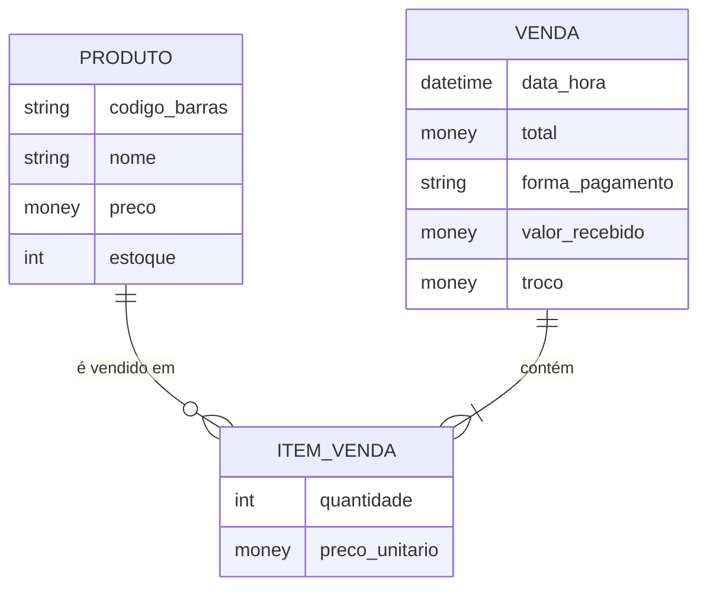
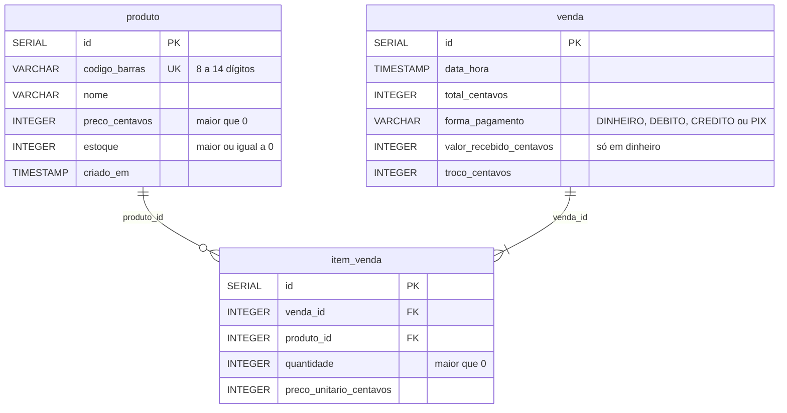

# 4. Projeto do banco de dados

SGBD escolhido: **PostgreSQL**, que é gratuito, de código aberto, popular no mercado e tem boa
documentação.

O projeto segue três etapas: **conceitual** (o que guardar), **lógico** (tabelas normalizadas) e
**físico** (o script SQL que cria o banco).

## 4.1 Modelo conceitual

Ele parte do diagrama de classes de persistência (Produto, Venda e ItemVenda).



**Cardinalidades**
- Uma **venda** contém **um ou mais** itens (1:N, obrigatório).
- Um **produto** pode aparecer em **zero ou mais** itens (1:N, opcional).
- Por isso, **Venda e Produto têm uma relação N:N**, resolvida pela entidade associativa **ITEM_VENDA**.

## 4.2 Modelo lógico (normalizado)



Em notação textual:

- **produto** (<u>id</u>, codigo_barras, nome, preco_centavos, estoque, criado_em)
- **venda** (<u>id</u>, data_hora, total_centavos, forma_pagamento, valor_recebido_centavos, troco_centavos)
- **item_venda** (<u>id</u>, *venda_id* → venda, *produto_id* → produto, quantidade, preco_unitario_centavos)

### Verificação da normalização

| Forma normal | Exigência | Situação no modelo |
|---|---|---|
| **1FN** | Atributos atômicos, sem grupos repetidos | ✔ Os itens de uma venda não ficam numa lista dentro de `venda`: cada item é uma linha de `item_venda`. |
| **2FN** | 1FN e nenhum atributo depende só de parte da chave | ✔ Todas as tabelas têm chave primária simples (`id`). Em `item_venda`, o par (venda_id, produto_id) é único, e `quantidade` e `preco_unitario_centavos` dependem do par inteiro. |
| **3FN** | 2FN e nenhum atributo depende de outro atributo não-chave | ✔ O nome e o código do produto **não** são repetidos em `item_venda`; são obtidos por `produto_id`. |

### Decisões de projeto (desnormalizações conscientes)

| Atributo | Por que existe |
|---|---|
| `item_venda.preco_unitario_centavos` | É o preço **no momento da venda**. Se o preço do produto mudar amanhã, a venda de hoje não pode mudar. Portanto não é redundância: é outro fato. |
| `venda.total_centavos` e `venda.troco_centavos` | Poderiam ser calculados a partir dos itens, mas foram gravados para que o histórico e o painel sejam rápidos e para registrar exatamente o valor cobrado. São calculados uma única vez, no servidor, dentro da transação. |

### Domínios dos atributos

O domínio é mais do que o tipo de dado (como diz o material da disciplina). As restrições abaixo são
garantidas **no banco**, com CHECK, UNIQUE e FK, e **também no código**, com as validações dos models.

| Atributo | Tipo | Domínio |
|---|---|---|
| codigo_barras | VARCHAR(14) | Somente dígitos, de 8 a 14 (EAN-8 a GTIN-14), único |
| nome | VARCHAR(100) | De 3 a 100 caracteres, sem espaços sobrando |
| preco_centavos | INTEGER | > 0 |
| estoque | INTEGER | ≥ 0 |
| forma_pagamento | VARCHAR(10) | {DINHEIRO, DEBITO, CREDITO, PIX} |
| valor_recebido_centavos | INTEGER | ≥ total quando é DINHEIRO; nulo nas demais formas |
| troco_centavos | INTEGER | ≥ 0 |
| quantidade | INTEGER | > 0 |

## 4.3 Projeto físico

O script completo está em [`database/schema.sql`](../../database/schema.sql) e os dados de exemplo em
[`database/seed.sql`](../../database/seed.sql).

Pontos principais:

- **Chaves primárias** `SERIAL` (auto-incremento).
- **Chaves estrangeiras** com regras de exclusão:
  - `item_venda.venda_id` usa `ON DELETE CASCADE`: se uma venda for apagada, os itens vão junto.
  - `item_venda.produto_id` usa `ON DELETE RESTRICT`: um produto já vendido não pode ser apagado (RN10).
- **Restrições CHECK** para cada domínio da tabela acima, inclusive a regra do valor recebido (RN08).
- **Índices** em `produto.nome` (busca), `venda.data_hora` (filtro por dia e painel) e
  `item_venda.produto_id` (verificar se o produto já foi vendido).
- **Dinheiro em centavos (INTEGER)**, para não haver erro de arredondamento com números decimais.

### Como criar o banco

```bash
createdb pdv
psql -d pdv -f database/schema.sql
psql -d pdv -f database/seed.sql      # opcional: produtos de exemplo
```

Ou, pela própria aplicação: `flask --app run init-db --exemplos` (veja o README).

### Validação do projeto físico

O script foi executado no PostgreSQL 16 e as restrições foram testadas com dados inválidos:

| Comando de teste | Resultado |
|---|---|
| Produto com código `12AB5678` | Bloqueado por `ck_produto_codigo_barras` |
| Produto com preço 0 | Bloqueado por `ck_produto_preco` |
| Venda em dinheiro com valor recebido menor que o total | Bloqueada por `ck_venda_recebido` |
| Venda com forma de pagamento `BOLETO` | Bloqueada por `ck_venda_pagamento` |
| Excluir produto que já tem venda | Bloqueado por `fk_item_venda_produto` |
