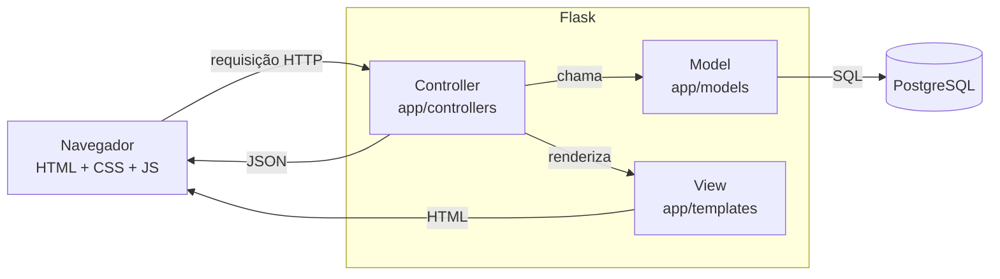

# Arquitetura: padrão MVC

O back-end usa **Python 3 + Flask**, organizado no padrão **MVC (Model-View-Controller)**, como indica a
disciplina.



| Camada | Pasta | Responsabilidade | Não faz |
|---|---|---|---|
| **Model** | `app/models/` | Regras de negócio (validações, cálculo de total e troco, baixa de estoque) e acesso ao banco | Não conhece HTML nem HTTP |
| **View** | `app/templates/` + `app/static/` | Montar as páginas (Jinja2), o estilo (CSS) e a interação no navegador (JavaScript) | Não acessa o banco |
| **Controller** | `app/controllers/` | Receber a requisição, chamar o Model e escolher a View ou a resposta JSON | Não contém regra de negócio |

## Estrutura de pastas

```
app/
├── __init__.py              # cria a aplicação, registra controllers e o tratamento de erros
├── db.py                    # conexão com o banco (PostgreSQL ou SQLite nos testes)
├── models/
│   ├── produto.py           # Model Produto (RN01–RN04, RN10, RN11)
│   ├── venda.py             # Model Venda e ItemVenda (RN05–RN09, RN12)
│   └── erros.py             # ErroValidacao, EstoqueInsuficiente, NaoEncontrado
├── controllers/
│   ├── inicio_controller.py # GET /
│   ├── produto_controller.py# /produtos/...
│   └── venda_controller.py  # /vendas/...
├── templates/               # Views (HTML com Jinja2)
├── static/css/style.css
├── static/js/carrinho.js    # lógica do carrinho (testada com node:test)
├── static/js/pdv.js         # liga a tela de venda ao carrinho e ao servidor
└── utils/dinheiro.py        # conversão reais ↔ centavos
```

## Rotas

| Método | Rota | Controller | Descrição |
|---|---|---|---|
| GET | `/` | inicio.painel | Painel do dia |
| GET | `/produtos/?busca=` | produtos.listar | Lista e busca produtos |
| GET/POST | `/produtos/novo` | produtos.novo | Cadastro |
| GET/POST | `/produtos/<id>/editar` | produtos.editar | Edição |
| POST | `/produtos/<id>/excluir` | produtos.excluir | Exclusão |
| GET | `/produtos/api/codigo/<codigo>` | produtos.buscar_por_codigo | JSON usado pela tela de venda |
| GET | `/produtos/api/busca?q=` | produtos.buscar_por_nome | JSON usado pela tela de venda |
| GET | `/vendas/nova` | vendas.nova | Tela de caixa |
| POST | `/vendas/` | vendas.finalizar | Recebe a venda em JSON e grava |
| GET | `/vendas/?data=AAAA-MM-DD` | vendas.listar | Histórico |
| GET | `/vendas/<id>` | vendas.detalhe | Comprovante |

## Tratamento de erros

- **Erros de regra de negócio** viram a exceção `ErroValidacao` no Model, e o Controller mostra a mensagem
  na tela (formulário com o campo em vermelho) ou devolve `400 {"erro": "..."}` para o JavaScript.
- **404 e 405** mostram uma página amigável.
- **Qualquer erro inesperado** é registrado no log e o usuário vê uma página 500 com uma mensagem
  amigável, sem detalhes técnicos.
- **Transações:** a venda inteira é gravada dentro de uma transação. Se algo falhar no meio (por exemplo,
  o estoque acabar porque outro caixa vendeu o mesmo produto ao mesmo tempo), é feito *rollback* e nada
  fica gravado pela metade.
- **Segurança básica:** o preço é sempre lido do banco (o navegador envia só id e quantidade), o SQL usa
  parâmetros (proteção contra SQL injection) e o JavaScript usa `textContent` (proteção contra injeção de
  HTML).
