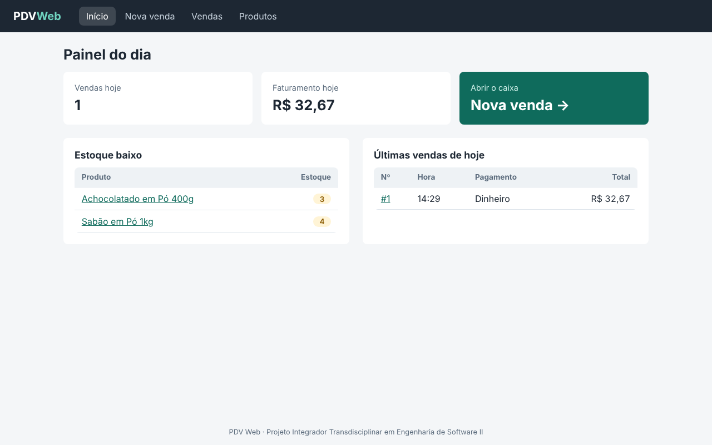
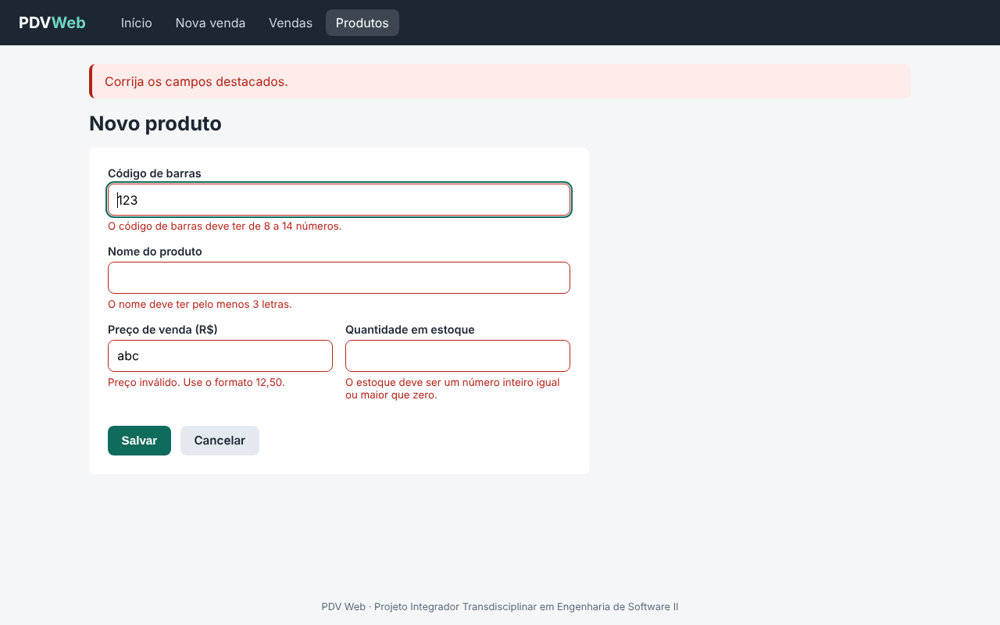
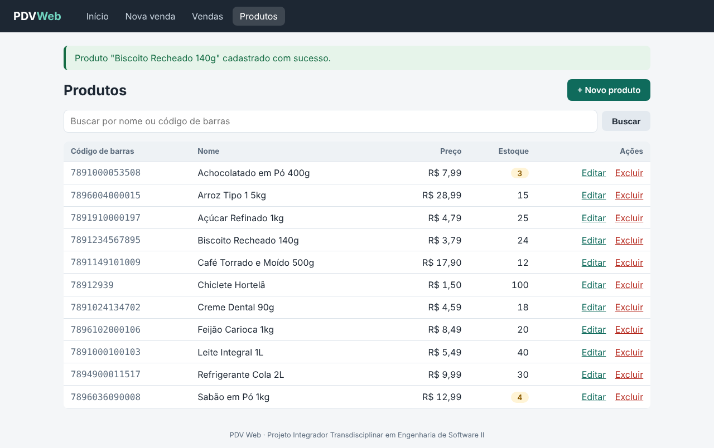
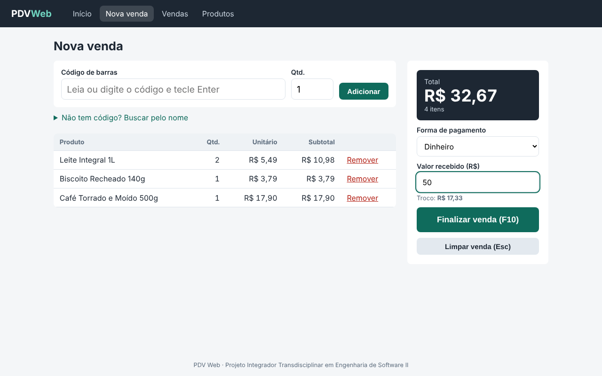
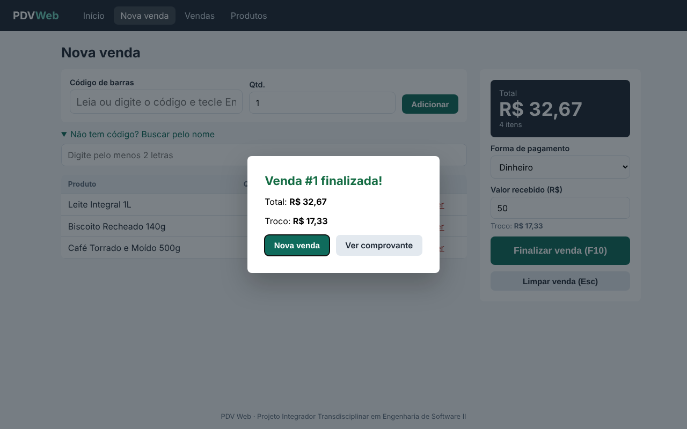
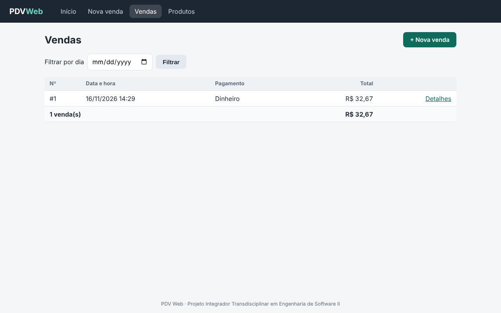
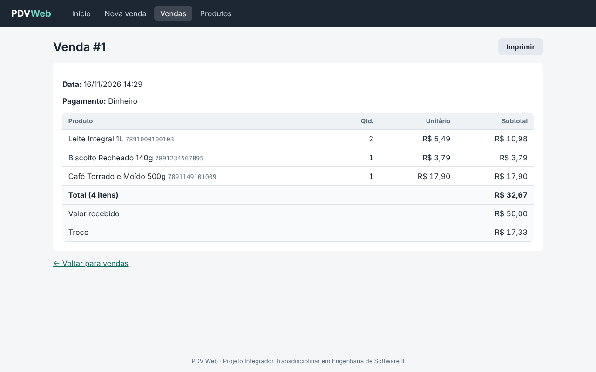

# Manual de uso: PDV Web

## 1. Acessar o sistema

Abra o endereço do sistema no navegador (Chrome, Edge ou Firefox). Para rodar no seu computador, siga a
seção "Como executar" do [README](../../README.md); o endereço será `http://127.0.0.1:5000`.

O menu superior está em todas as telas: **Início**, **Nova venda**, **Vendas** e **Produtos**.

## 2. Painel do dia (Início)

- **Vendas hoje** e **Faturamento hoje**: quantas vendas foram feitas hoje e quanto somaram.
- **Estoque baixo**: produtos com 5 unidades ou menos. Clique no nome para ajustar o estoque.
- **Últimas vendas de hoje**: clique no número para ver o comprovante.

## 3. Produtos

### 3.1 Cadastrar

1. Clique em **Produtos** e depois em **+ Novo produto**.
2. Preencha:
   - **Código de barras**: os números embaixo do código na embalagem (8 a 14 dígitos). Com um leitor de
     código de barras, basta clicar no campo e ler.
   - **Nome do produto**.
   - **Preço de venda**: use vírgula, por exemplo `12,50`.
   - **Quantidade em estoque**.
3. Clique em **Salvar**.

Se algum campo estiver errado, ele fica vermelho com a explicação embaixo, e o que você digitou não se
perde:

### 3.2 Buscar, editar e excluir

- **Buscar**: digite parte do nome ou o código completo e clique em **Buscar**.
- **Editar**: clique em **Editar** na linha do produto, altere e salve.
- **Excluir**: clique em **Excluir** e confirme. Produtos que já foram vendidos **não podem ser
  excluídos**, para não apagar o histórico; nesse caso, deixe o estoque em zero.
- Os números de estoque em amarelo indicam estoque baixo; em vermelho, estoque zerado.

## 4. Registrar uma venda

1. Clique em **Nova venda**. O cursor já fica no campo **Código de barras**.
2. Se o cliente levar mais de uma unidade, altere **Qtd.** antes.
3. Leia o código com o leitor ou digite e tecle **Enter**. O produto entra na lista e o **Total**
   atualiza.
4. Produto sem código legível? Clique em **Não tem código? Buscar pelo nome**, digite parte do nome e
   clique no produto.
5. Para tirar um item, clique em **Remover**. Para começar de novo, clique em **Limpar venda** ou tecle
   **Esc**.
6. Escolha a **Forma de pagamento**:
   - **Dinheiro**: digite o **Valor recebido** e o **Troco** aparece na hora. O botão Finalizar só é
     liberado quando o valor recebido cobre o total.
   - **Cartão de débito, Cartão de crédito ou Pix**: não precisa informar valor.
7. Clique em **Finalizar venda** ou tecle **F10**.

8. Aparece o número da venda e o troco. Clique em **Nova venda** para o próximo cliente ou em **Ver
   comprovante** para imprimir.

### Atalhos de teclado

| Tecla | Ação |
|---|---|
| Enter | Adiciona o produto do campo de código |
| F10 | Finaliza a venda |
| Esc | Limpa a venda (pede confirmação) |

## 5. Consultar vendas

- Clique em **Vendas** para ver todas as vendas, das mais novas para as mais antigas, com o total no
  rodapé.
- Para ver um dia específico, escolha a data e clique em **Filtrar**.
- Clique em **Detalhes** para ver o comprovante, com itens, valor recebido e troco. Use **Imprimir** para
  imprimir.

## 6. Mensagens comuns e o que fazer

| Mensagem | O que fazer |
|---|---|
| Nenhum produto com o código X | O produto não está cadastrado. Cadastre-o em Produtos ou confira o código. |
| Estoque insuficiente para "…". Disponível: N | Diminua a quantidade ou atualize o estoque do produto. |
| Código inválido: use de 8 a 14 números | O código foi digitado errado (letras ou tamanho errado). |
| Sem conexão com o servidor. A venda não foi gravada. | Verifique a internet ou se o sistema está no ar e finalize de novo. |
| Já existe um produto com este código | Esse produto já está cadastrado. Use a busca e edite o existente. |
